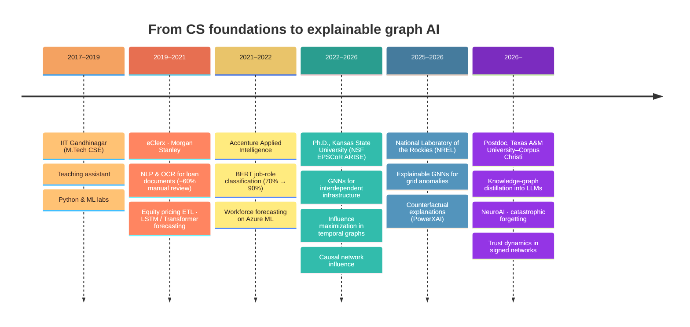

<h1 align="center">Hi, I'm Priyanka Gautam, Ph.D. 👋</h1>

<p align="center">
  <a href="https://priyankagautam08.github.io/research/"></a>
</p>

<p align="center">
  <a href="https://priyankagautam08.github.io/research/"></a>
  <a href="https://scholar.google.com/citations?user=7uzapiUAAAAJ&hl=en"></a>
  <a href="https://www.linkedin.com/in/priyankagautam08/"></a>
  <a href="mailto:priyankagautam099@gmail.com"></a>
</p>

### 🧑‍💻 About me

```python
priyanka = {
    "role":       "Postdoctoral Research Associate @ Texas A&M University–Corpus Christi",
    "phd":        "Electrical & Computer Engineering, Kansas State University (2026)",
    "now":        "Distilling knowledge graphs into LLMs",
    "previously": ["Ph.D. intern @ National Laboratory of the Rockies (NREL): explainable GNNs for the power grid",
                   "Data Scientist @ Accenture Applied Intelligence",
                   "Applied AI @ eClerx, incl. Morgan Stanley: NLP for financial documents, pricing analytics"],
    "focus":      ["graph ML", "explainable AI", "causal inference", "LLMs / RAG", "fraud & risk", "infrastructure resilience"],
    "code_daily": ["Python", "SQL", "PyTorch", "PyTorch Geometric"],
}
```

- 🔭 Building a **counterfactual explainer for PyTorch Geometric** and explainability for **NVIDIA's GNN fraud-detection blueprint**
- 🌱 Working on: knowledge-graph → LLM distillation, temporal & signed networks, brain-network measures for continual learning
- 📘 Doing **[30 Days of ML Foundations](https://github.com/Priyankagautam08/ml-from-scratch)**: every core ML algorithm from scratch, in public
- 👯 Open to collaborating on **graph learning, explainable AI and causal ML**
- 💬 Ask me about: GNNs at scale, counterfactual explanations, influence maximization, explainable credit/fraud models

---

### 🛠️ Languages & tools

<p align="center">
  
</p>

<table width="100%">
<tr><td valign="top" width="50%"><b>💻 Languages</b><br>    </td><td valign="top" width="50%"><b>🧠 ML / DL</b><br>       </td></tr>
<tr><td valign="top" width="50%"><b>🤖 LLMs & NLP</b><br>     </td><td valign="top" width="50%"><b>🗄️ Data</b><br>    </td></tr>
<tr><td valign="top" width="50%"><b>☁️ MLOps & cloud</b><br>     </td><td valign="top" width="50%"><b>📊 Visualization</b><br>  </td></tr>
</table>

---

### 🧭 My journey

```mermaid
flowchart LR
    A["Data science & NLP<br/><i>industry</i>"] --> B["Graph ML<br/><i>GNNs at scale</i>"]
    B --> C["Network science<br/><i>resilience · influence</i>"]
    C --> D["Causal & explainable AI<br/><i>counterfactuals</i>"]
    D --> E["LLMs + knowledge graphs<br/><i>distillation · RAG</i>"]
    E --> F["Trustworthy AI for<br/>finance & critical systems"]
    classDef s1 fill:#F4A261,stroke:#C9733A,color:#1b1b1b
    classDef s2 fill:#E9C46A,stroke:#B8962F,color:#1b1b1b
    classDef s3 fill:#2A9D8F,stroke:#1E7066,color:#ffffff
    classDef s4 fill:#457B9D,stroke:#2F5670,color:#ffffff
    classDef s5 fill:#7B2CBF,stroke:#561F87,color:#ffffff
    classDef s6 fill:#E76F51,stroke:#B04F36,color:#ffffff
    class A s1
    class B s2
    class C s3
    class D s4
    class E s5
    class F s6
```





**Interests:** graph foundation models · explainable & counterfactual AI · causal ML · LLM reasoning with knowledge graphs · fraud & risk modeling · NeuroAI · network science · AI for social good

---

### 🧠 What I build

| Capability | What I've done |
|---|---|
| **Graph neural networks** | GCN / GraphSAGE pipelines on HPC; heterogeneous & temporal graphs; node, link and graph prediction; 97–99% critical-component accuracy on a 1,300-node infrastructure network |
| **Explainable AI** | Counterfactual explanations for GNNs (COMBINEX-style), physics-validated on power feeders; SHAP + LLM reason codes with faithfulness checks; fidelity metrics |
| **Causal ML** | Causal network influence (IEEE Access 2026); causal effect estimation beyond centrality |
| **LLMs & GenAI** | Knowledge-graph distillation into LLMs; RAG; fine-tuning BERT/GPT (classification 70% → 90%); LLM agents and evaluation |
| **NLP & document AI** | Loan-document extraction (OCR + NER) that cut manual review by 60%+ |
| **Fraud, credit & finance ML** | Explainable credit-risk model (ROC-AUC 0.869) with cost-based thresholds and fairness checks; GNN fraud detection on transaction graphs (Elliptic); equity pricing & forecasting (LSTM/Transformers) |
| **Data & MLOps** | ETL on Hadoop/Hive & PySpark; Azure ML pipelines; Docker, Git, CI/CD |

---

### 🚀 Featured projects

| Project | Highlights | Stack |
|---|---|---|
| 📘 [**30 Days of ML Foundations**](https://github.com/Priyankagautam08/ml-from-scratch) · ongoing | 11 core algorithms + attention from scratch in NumPy: math guides, scikit-learn comparison tests, timed interview drills, a 30-day roadmap | NumPy, scikit-learn, pytest |
| 🌐 [**Dynamic Influence Maximization**](https://github.com/Priyankagautam08/DynamicGraphInfluenceMaximization-AAAI2025) · AAAI-25 workshop | GNN-BiLSTM that tracks influential nodes in evolving networks without recomputing from scratch | PyTorch Geometric, NetworkX |
| 💳 [**Credit risk with explainability**](https://github.com/Priyankagautam08/credit-risk-xai-llm) | XGBoost + SHAP + LLM reason codes (faithfulness-checked), cost-based thresholds, age-group fairness check · ROC-AUC 0.869 | XGBoost, SHAP, LLMs |
| 🕵️ [**GNN fraud detection: CPU fallback**](https://github.com/Priyankagautam08/financial-fraud-detection/tree/cpu-fallback) · contribution to NVIDIA's blueprint | Made the TabFormer graph pipeline run without a GPU ([issue #22](https://github.com/NVIDIA-AI-Blueprints/financial-fraud-detection/issues/22)) | Python, pandas, cuDF |
| 🤖 [**MindLift AI**](https://github.com/Priyankagautam08/mindlift-ai) | Multi-agent emotional-wellness companion (Google 5-Day AI Agents Intensive capstone) | Python, LLM agents |
| 📄 [**Research website**](https://priyankagautam08.github.io/research/) | Papers, projects, talks and community work ([source](https://github.com/Priyankagautam08/research)) | JavaScript |

**Coming soon (code released with the papers):** PowerXAI (counterfactual GNN explanations for power feeders, with NLR) · WEGL-IM (Wasserstein embeddings for change-aware influence maximization) · catastrophic-forgetting detection with brain-network measures (AAAI-27 NeuroAI workshop) · trust dynamics on signed temporal networks (NetSci 2027)

---

### 📚 Selected publications

<details>
<summary><b>5 papers in IEEE Access, IJDRR, AAAI workshop, IEEE GreenTech and IEEE SmartGridComm</b> (click to expand)</summary>

- **Beyond Structure: A Causal Perspective on Network Influence.** *IEEE Access*, 2026. [[paper]](https://ieeexplore.ieee.org/abstract/document/11687743)
- **Scalable Criticality Analysis in Interdependent Infrastructure Systems using Functionality Graphs.** *Int. J. of Disaster Risk Reduction*, 2026. [[paper]](https://www.sciencedirect.com/science/article/pii/S2212420926003729)
- **GNN-Based Candidate Node Predictor for Influence Maximization in Temporal Graphs.** *AAAI 2025 Workshop*. [[arXiv]](https://arxiv.org/abs/2503.23713) [[code]](https://github.com/Priyankagautam08/DynamicGraphInfluenceMaximization-AAAI2025)
- **GNN-based Criticality Analysis in Interconnected Infrastructure Networks.** *IEEE GreenTech*, 2024. [[paper]](https://ieeexplore.ieee.org/abstract/document/10520547)
- **A Transductive Graph Neural Network Learning for Grid Resilience Analysis.** *IEEE SmartGridComm*, 2023. [[paper]](https://ieeexplore.ieee.org/abstract/document/10333912)

Full list on [Google Scholar](https://scholar.google.com/citations?user=7uzapiUAAAAJ&hl=en).
</details>

---

### 📊 GitHub stats

<p align="center">
  
  
</p>
<p align="center">
  
</p>
<p align="center">
  
</p>

---

### 🌟 Leadership & mentoring

*Aspiring research leader and mentor: I like building teams and communities as much as building models.*

<table width="100%">
<tr>
<td valign="top" width="50%">

**Leadership development**
- 🎓 **McKinsey.org Forward Program**: graduate; structured problem solving, communication and leading through change
- 🏛️ **Stanford Continuing Studies**: *AI-Powered Leadership: Transforming Impact in the Digital Age* (BUS 148, 2026)
- 🚀 **GradEdge**, Kansas State University: graduate leadership development program

</td>
<td valign="top" width="50%">

**Community & mentoring**
- 👩‍💻 **Founder & Chair**, ACM-W Student Chapter, Kansas State University (2023–present)
- 📝 **Reviewer**, Women in Machine Learning (WiML) Workshop (2025–present)
- 🎓 **Mentor**, Women in Engineering Program, Kansas State University
- 🧩 **Workshop host**, hands-on GNNs with PyTorch Geometric, K-State (2024)
- 🎤 **Invited talk**, MINK WIC 2025: Generative AI and workforce transformation

</td>
</tr>
</table>

---

### ✍️ Beyond research

I write **[LiveLiftUp](https://liveliftup.com)** (*Live, lift, level up*), documenting the in-between: tech and AI explainers, breaking into AI, the corporate-to-Ph.D. path, fitness, travel and national-park hikes.

<p>
  <a href="https://liveliftup.com"></a>
  <a href="https://www.youtube.com/@liveliftup"></a>
  <a href="https://www.instagram.com/liveliftup"></a>
</p>

<p align="center"><sub>Open to research collaborations and roles in applied ML / research science. Let's connect!</sub></p>
